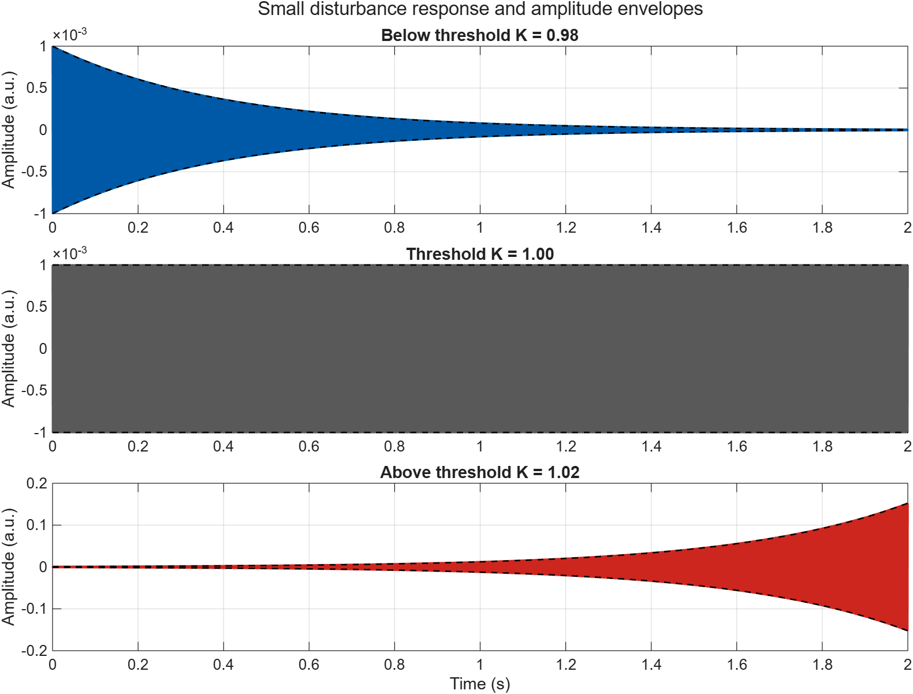
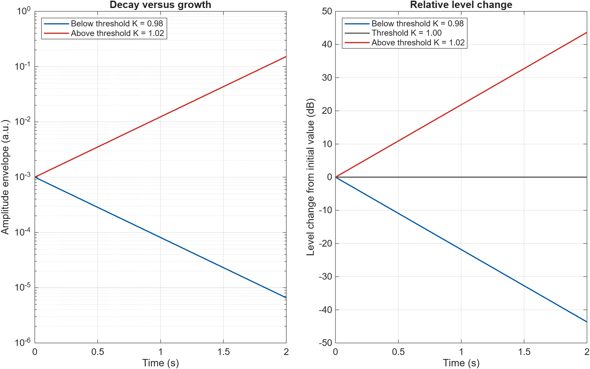
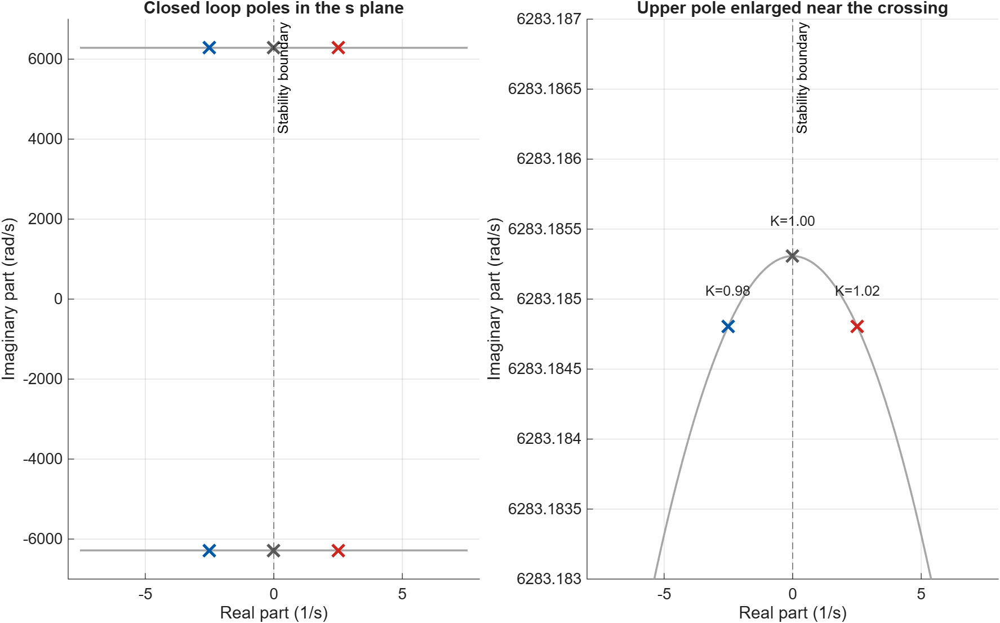
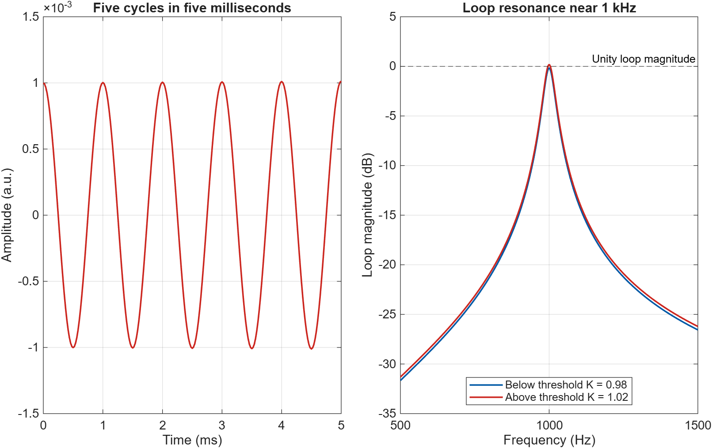

# Microphone Speaker Feedback and the Onset of Squeal

A MATLAB simulation of acoustic feedback that demonstrates how a small change in loop gain turns a fading tone into a growing squeal. The project connects Laplace transforms, pole locations, and stability to the microphone and loudspeaker feedback loop.

## Requirements

- MATLAB R2026a or later
- Base MATLAB only

No additional toolboxes or audio hardware are required. The simulation does not play audio.

## Run

1. Clone or download this repository.
2. Open `acoustic_feedback.m` in MATLAB.
3. Click **Run**.

The script generates four figures and saves the plots, numerical summary, simulation data, and execution log in `results/`.

## Model

The acoustic path is approximated by a single resonant bandpass mode with positive feedback:

```text
G(s) = 2*zeta*w0*s / (s^2 + 2*zeta*w0*s + w0^2)
H(s) = G(s) / (1 - K*G(s))
```

The closed loop characteristic equation is:

```text
s^2 + 2*zeta*w0*(1 - K)*s + w0^2 = 0
```

The resonance is 1000 Hz, the open path damping ratio is 0.02, and the critical normalized feedback gain is `K = 1`.

## Results

Each case starts with an amplitude of 0.001 arbitrary units and runs for two seconds at a sample rate of 48000 Hz.

| Feedback gain | Pole real part (1/s) | Final envelope | Relative level change | Behaviour |
| --- | --- | --- | --- | --- |
| 0.98 | -2.513274 | 0.000006561 | -43.6600 dB | Decays |
| 1.00 | 0 | 0.001000000 | 0 dB | Constant free oscillation |
| 1.02 | +2.513274 | 0.152406036 | +43.6600 dB | Grows |

The pole pair crosses the imaginary axis at `K = 1`. The oscillation frequency remains approximately 1000 Hz. At the threshold, the free response persists, but the system is not BIBO stable.

### Time responses

Below threshold the disturbance fades. Above threshold its envelope grows exponentially. The panels use different vertical scales.



### Volume comparison

The amplitude envelopes show the opposite trends directly. The decibel plot measures change relative to the initial amplitude, not calibrated sound pressure level.



### Pole locations

The stable poles lie in the left half plane. Increasing the gain through the threshold moves them into the right half plane.



### Squeal pitch

The short waveform shows five cycles in five milliseconds. The loop magnitude peaks near the selected 1000 Hz acoustic mode.



## Validation

Executed in MATLAB R2026a Update 4. The script checks the characteristic polynomial residuals, verifies the stability signs, and compares the sampled state response with the analytical solution. The maximum normalized error was `3.92e-12`.

## Files

| File | Description |
| --- | --- |
| `acoustic_feedback.m` | Complete simulation and validation script |
| `results/*.png` | MATLAB output plots |
| `results/summary.csv` | Numerical results for all three gains |

Running the script also creates editable `.fig` figures, `simulation_data.mat`, and `matlab_execution.txt` in `results/`.

## Scope

This is a linear single mode model of the onset of acoustic feedback. It does not include propagation delay, multiple room modes, or output saturation. Real hardware eventually clips instead of growing without limit.

made with ❤️ by aarya
